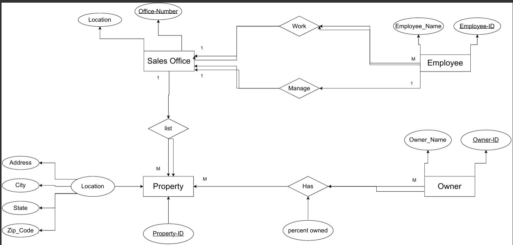
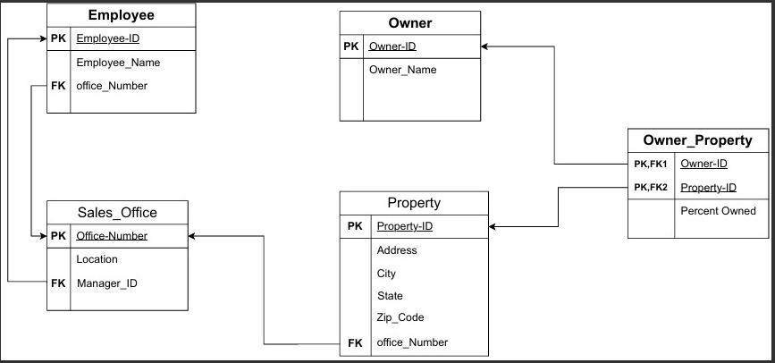
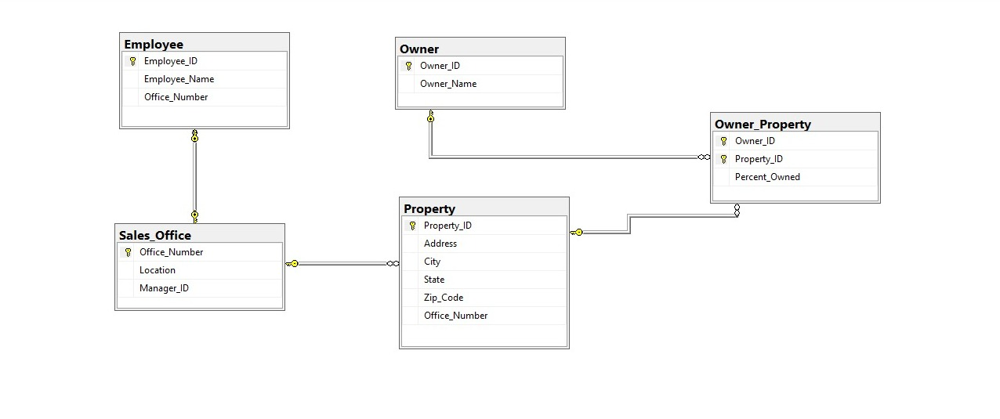

<div align="center">

# 🏢 Real Estate Firm — Database Design & Implementation

### A Relational Database Design & Implementation Solution Using Microsoft SQL Server

**Designing and implementing an end-to-end relational database solution for managing real estate operations.**

[](https://www.microsoft.com/sql-server)
[](https://learn.microsoft.com/sql/)
[](https://app.diagrams.net/)

</div>

---

# 📌 Project Overview

This project focuses on designing and implementing a comprehensive relational database for a **Real Estate Firm** using **Microsoft SQL Server**.

The project follows the full database development lifecycle—starting from analyzing core business requirements, designing an Entity-Relationship Diagram (ERD), performing relational mapping and normalization, to physical database implementation and integrity testing.

The final database efficiently manages sales offices, employees, properties, and property owners while maintaining strict data integrity through primary keys, foreign keys, unique constraints, and check constraints.

---

# 🎯 Business Requirements

The database is designed to support and automate the following key business operations:

- **Sales Office Management:** Manage multiple sales offices operating across different states.
- **Employee Assignment:** Assign employees to sales offices, ensuring each employee belongs to exactly one office.
- **Office Leadership:** Designate one employee as the manager of each sales office.
- **Property Tracking:** Manage real estate properties listed through specific sales offices.
- **Location Details:** Store comprehensive property location details, including address, city, state, and ZIP code.
- **Ownership Structure:** Track multi-owner properties and multi-property owners (supporting many-to-many ownership relationships).
- **Ownership Shares:** Accurately record and validate each owner's percentage of ownership in a property.

---

# 🧰 Tools & Technologies

| Tool / Technology | Purpose |
|---|---|
| **Microsoft SQL Server** | Relational Database Management System (RDBMS) for data hosting and management |
| **SQL** | Creating database schema, defining constraints, data manipulation, and integrity testing |
| **Draw.io** | Designing conceptual ERD and logical relational mapping diagrams |
| **SSMS (SQL Server Management Studio)** | Database administration, script execution, and visual schema verification |

---

# 🗄️ Database Design Lifecycle

The database design process followed a structured four-stage approach:

### 1. Entity-Relationship Diagram (ERD)
Identified core entities, primary attributes, and business relationships based on requirements.
- **Main Entities:** `Employee`, `Sales_Office`, `Property`, `Owner`

<p align="center">
  
</p>

### 2. Relational Mapping
Mapped the ERD into normalized relational tables by establishing Primary Keys (PKs), Foreign Keys (FKs), and creating an associative entity (`Owner_Property`) to resolve the many-to-many relationship between owners and properties.

<p align="center">
  
</p>

### 3. Normalization
Analyzed functional dependencies across all attributes to eliminate data redundancy and anomalies. The database schema satisfies **Third Normal Form (3NF)** requirements.

### 4. Physical Database Design
Implemented the logical schema directly in Microsoft SQL Server, incorporating:
- Data type selection and `NOT NULL` constraints.
- Primary Key and Foreign Key constraints.
- Filtered unique indexes to enforce business rules (e.g., manager uniqueness).
- `CHECK` constraints to ensure ownership percentages remain valid ($\le 100\%$).
- Execution ordering to handle circular table dependencies.

---

# 📋 Database Structure & Schema

The database consists of five core tables:

| Table | Description | Key Relationships & Constraints |
|---|---|---|
| `Sales_Office` | Stores sales office details and location info | Managed by an `Employee` (1:1 filtered unique) |
| `Employee` | Stores staff details and employment assignment | Belongs to a `Sales_Office` (1:N) |
| `Property` | Stores listed property details and address | Managed by a `Sales_Office` (1:N) |
| `Owner` | Stores property owner contact details | Links to properties via `Owner_Property` |
| `Owner_Property` | Associative table resolving Owner-Property M:N relation | Tracks `Percent_Owned` with `CHECK` constraints |

### Summary of Relationships
- **Sales_Office $\rightarrow$ Employee:** One-to-Many ($1:N$)
- **Employee $\leftrightarrow$ Sales_Office (Manager):** One-to-One ($1:1$) via filtered unique index
- **Sales_Office $\rightarrow$ Property:** One-to-Many ($1:N$)
- **Owner $\leftrightarrow$ Property:** Many-to-Many ($M:N$) resolved via `Owner_Property`

---

# ⚙️ Implementation & Data Integrity Testing

To guarantee robustness, the implemented SQL schema was thoroughly tested using both positive operational queries and negative constraint violation tests.

### Integrity Validation Highlights
- **Circular Dependency Resolution:** Created `Sales_Office` and `Employee` tables, inserted initial records, and then updated the `Manager_ID` foreign keys.
- **Manager Uniqueness:** Enforced via a **Filtered Unique Index** ensuring no employee can manage more than one sales office.
- **Ownership Validation:** Enforced via `CHECK` constraints prohibiting invalid percentage values.

### Test Matrix

| Test Scenario | Executed Operation | Expected & Observed Result | Status |
|---|---|---|:---:|
| **Duplicate PK Insertion** | Insert duplicate `Employee_ID` | ❌ Rejected: Primary Key violation | Passed |
| **Invalid Foreign Key** | Reference non-existing `Office_Number` | ❌ Rejected: Foreign Key violation | Passed |
| **Multiple Office Management** | Assign same manager to multiple offices | ❌ Rejected: Unique index violation | Passed |
| **Invalid Ownership Share** | Insert `Percent_Owned` $> 100\%$ | ❌ Rejected: Check constraint violation | Passed |
| **Valid Workflow Testing** | Valid `INSERT`, `SELECT`, and `JOIN` | ✅ Approved: Data recorded successfully | Passed |

---

# 📊 Database Diagram

The following diagram illustrates the final physical structure generated directly in Microsoft SQL Server:

<p align="center">
  
</p>

---

# 📁 Repository Structure

```text
Real_State_Firm_Design/
│
├── Diagrams/
│   ├── Database_Diagram.jpeg
│   ├── ERD.jpeg
│   └── Mapping.jpeg
│
├── SQL_Scripts/
│   ├── Real_State_Firm_Physical_Design.sql
│   └── Real_State_Firm_Implementation.sql
│
└── README.md

---

# 🚀 How to Run the Project

Clone the repository:

```bash
git clone git@github.com:MohamedAlaaWork33/Real_State_Firm_Design.git
```

Open SSMS: Launch SQL Server Management Studio and connect to your SQL Server instance.

Execute Schema Creation:

Open SQL_Scripts/Real_State_Firm_Physical_Design.sql.

Run the script to generate the database, tables, indexes, and constraints.

Execute Data Insertion & Verification:

Open SQL_Scripts/Real_State_Firm_Implementation.sql.

Run the script to populate sample data and perform verification tests.

⚠️ Important: Execute the SQL scripts in the exact order specified above to avoid foreign key dependency errors.

---

# 📚 Key Learning Outcomes
## Through this project, I strengthened my practical expertise in:

Translating complex business rules into a structured relational database schema.

Conceptual and Logical modeling (ERD generation & Relational Mapping).

Database Normalization principles up to Third Normal Form (3NF).

DDL & DML script writing in SQL and Microsoft SQL Server.

Designing advanced integrity rules using Filtered Unique Indexes and Check Constraints.

Handling complex table circular dependencies during table creation and population.

Conducting systematic database verification using positive and negative test cases.

---

# 📧 Contact

**Mohamed Alaa**

Computer Science Graduate | Aspiring Data Analyst

📧 **Email**  
mohamedalaawork33@gmail.com

💻 **GitHub**  
https://github.com/MohamedAlaaWork33

🔗 **LinkedIn**  
https://www.linkedin.com/in/mohamed-alaa-1a283a230/

---